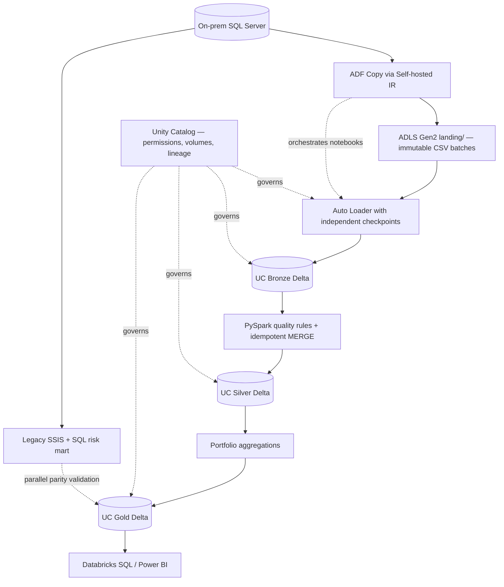

# CreditRisk Modernization — SSIS to Azure Databricks Lakehouse

> Portfolio reference implementation: SQL Server + SSIS legacy reporting → ADF incremental extraction → ADLS Gen2 → Databricks Auto Loader → Delta Lake Bronze/Silver/Gold → Unity Catalog governance.

**Status:** The synthetic-data generator and baseline tests run locally with Python 3.10+. The cloud paths require an Azure subscription, a Unity Catalog-enabled Azure Databricks workspace, an Azure Data Factory, and an accessible SQL Server source. No Azure resources have been provisioned and no Databricks jobs have been executed as part of this deliverable.

## Business problem

A lender calculates its consumer-loan portfolio metrics nightly with three SSIS packages and SQL Server reporting tables. Growing data volumes, repeated manual fixes, tightly coupled packages, and limited lineage motivate a progressive modernization without changing the published KPI definitions.

**Key entities:** `Customers`, `Loans`, `Payments`; **Gold metrics:** loan count, total principal, outstanding exposure, overdue exposure, collected payments, overdue exposure ratio, grouped by region and risk band as of a specified date. Data is **synthetic**.

## Architecture



## Repository map

| Path | Purpose |
|---|---|
| `legacy/sql/01_schema.sql` | SQL Server source schema |
| `legacy/sql/02_legacy_risk_mart.sql` | Legacy SQL baseline logic |
| `legacy/ssis_package_spec.md` | Realistic package-by-package SSIS definition; no fabricated executable `.dtsx` |
| `adf/pipeline/PL_CreditRiskMigration.json` | ADF 3-way extraction followed by Databricks orchestration |
| `adf/dataset/*.json` | SQL Server source and ADLS CSV sink datasets |
| `databricks/sql/00_bootstrap_uc.sql` | Unity Catalog schema/volume setup |
| `databricks/notebooks/00_run_pipeline.py` | ADF entry notebook |
| `databricks/notebooks/01_bronze.py` | Auto Loader CSV ingestion; separate checkpoints |
| `databricks/notebooks/02_silver.py` | Quality rules, deduplication, Delta MERGE |
| `databricks/notebooks/03_gold.py` | Reproducible point-in-time portfolio aggregation |
| `databricks/notebooks/04_validate.py` | Cloud-side integrity and reconciliation assertions |
| `demo/generate_data.py` | Locally generate deterministic synthetic CSV landing files and baseline |
| `demo/reconcile_gold.py` | Compare exported cloud Gold output with legacy baseline |
| `tests/test_baseline.py` | Stdlib tests of baseline calculations |
| `infra/` | Optional Terraform starter for Azure resources |
| `docs/migration_runbook.md` | Deployment, backfill, cutover, security and failure scenarios |

## Quickstart — local (no Azure needed)

```powershell
python demo/generate_data.py --out demo/generated --as-of-date 2026-10-31
python -m unittest discover -s tests -v
```

The script produces three CSV files under `demo/generated/landing/{customers,loans,payments}/run_local_001/` and `demo/generated/legacy_gold_baseline.csv`. Review the results; to compare them with an **actual** Databricks Gold export:

```powershell
python demo/reconcile_gold.py --expected demo/generated/legacy_gold_baseline.csv --actual path/to/exported_gold.csv
```

The baseline is computed from the **current-row synthetic source snapshot**, with the same KPI definitions as the Gold notebook. It is not evidence of a successful Azure migration until a real cloud export has been compared.

## Cloud deployment — follow this sequence

1. Provision or select SQL Server, ADLS Gen2 hierarchical namespace storage, ADF, and an Azure Databricks workspace with Unity Catalog (see `infra/`). Install and register ADF **Self-hosted Integration Runtime** on a Windows host with access to source SQL Server.
2. Apply `legacy/sql/01_schema.sql` to a **nonproduction** database; load the generated synthetic files into the three SQL Server tables **in order: Customers → Loans → Payments** (use SQL import tools, preserving datetime/decimal fields). Use `legacy/sql/02_legacy_risk_mart.sql` as the SQL baseline query.
3. In Azure, configure the Databricks Access Connector managed identity with appropriate access to the ADLS landing storage. Register a **Unity Catalog storage credential and external location** for `abfss://landing@STORAGE_ACCOUNT.dfs.core.windows.net/`; never put storage keys in notebooks. See `docs/migration_runbook.md`.
4. Edit `databricks/sql/00_bootstrap_uc.sql` to replace `STORAGE_ACCOUNT`, optionally change `creditrisk_dev`, and run it with privileges to create UC objects. The external location must exist **before** the external volume is created. The managed `ops.state` volume holds checkpoints and schema tracking **outside** the landing source.
5. Create ADF linked services named `LS_SQLSERVER`, `LS_ADLS`, `LS_DATABRICKS` using portal-managed credentials/identities. Import `adf/dataset/*.json` and `adf/pipeline/PL_CreditRiskMigration.json`; create notebook folders at `/Shared/creditrisk-migration` (or update `notebookPath` in ADF and `base_path` in notebook settings). For the Databricks linked service use UC-compatible compute and appropriate workspace permissions.
6. Import the five `.py` files as Databricks notebooks, preserving the filenames **without** the `.py` suffix where applicable, in `/Shared/creditrisk-migration`. Configure the ADF notebook task to run `/Shared/creditrisk-migration/00_run_pipeline`. Set ADF pipeline parameters `window_start`, `window_end`, `as_of_date`, `catalog`.
7. Start with a full historical backfill window, then schedule non-overlapping incremental windows. Copy activities write immutable, run-specific CSV filenames. Run the pipeline and query `creditrisk_dev.gold.portfolio_risk_daily`.
8. Run validations, compare the new KPI output against the legacy SQL/SSIS mart, and document your cutover/rollback decision. See `docs/migration_runbook.md`.

**Notes on semantics:** In this demo, `updated_at` is a source-level change timestamp and captures inserts/updates only. **Hard deletes are not captured**; a production migration must use SQL Server CDC/change tracking or explicit tombstones. For deterministic financial snapshots, source systems must expose historical states as-of the reporting date. This demo takes the latest ingested row for each entity and produces an as-of-date payment/overdue aggregation; it is **not** a full historical point-in-time ledger.

## Portfolio acceptance criteria

- [ ] ADF extracts three sources over an explicit watermark interval using self-hosted IR.
- [ ] Each ADF run creates new, immutable CSV landing paths.
- [ ] Auto Loader ingests new files without resetting schema/checkpoint paths.
- [ ] Silver tables have unique business keys and reject invalid records.
- [ ] Re-running the same date and same source files preserves Gold values.
- [ ] Gold metrics reconcile to legacy SQL output at defined tolerance.
- [ ] Unity Catalog grants follow least privilege; lineage is demonstrable.
- [ ] Alerts and failure recovery are documented; source pipeline is not retired before parallel validation.

## Architecture decisions / tradeoffs

- Keep ADF for on-premises connectivity and orchestration; move transformations to Databricks. Azure-SSIS IR may provide temporary compatibility but is **not** the target compute for the refactored SSIS logic.
- Use Auto Loader `availableNow` for daily micro-batches, not a permanently running stream. Keep stable checkpoint per entity, not per run.
- Use UC managed Delta tables and managed state volume; external landing volume points to ADLS files written by ADF.
- Silver Delta `MERGE` is upsert-only, with `updated_at` conflict resolution. Add CDC tombstones and a watermark control table for a production-grade migration.
- Production readiness requires durable watermark commits, late-arriving corrections policy, backfill partition plans, lineage screenshots, ADF alerts, SLAs, access reviews and cost/performance benchmarks.

## Current limitations (intentionally explicit)

This repository is a functional **starter**, not an out-of-the-box deployed application: Azure resource provisioning, networking, linked-service authentication, SQL Server seed import, Databricks notebook import, and Unity Catalog storage-credential registration are environment-specific. Terraform does not create UC storage credentials/external locations or ADF linked services. Actual SSIS `.dtsx` binaries must be authored/exported with SSDT; this repository provides their package specs and SQL equivalent. The notebooks require Databricks runtime and are not runnable under vanilla local PySpark due to `cloudFiles` and `dbutils`.

## Relevant official references

- [Microsoft: migrate SSIS to ADF](https://learn.microsoft.com/en-us/azure/data-factory/scenario-ssis-migration-overview)
- [Microsoft: SQL Server ADF connector](https://learn.microsoft.com/en-us/azure/data-factory/connector-sql-server)
- [Microsoft: ADF Databricks Notebook](https://learn.microsoft.com/en-us/azure/data-factory/transform-data-using-databricks-notebook)
- [Microsoft: Auto Loader with Unity Catalog](https://learn.microsoft.com/en-us/azure/databricks/ingestion/cloud-object-storage/auto-loader/unity-catalog)
- [Microsoft: Auto Loader checkpoint best practices](https://learn.microsoft.com/en-us/azure/databricks/ingestion/cloud-object-storage/auto-loader/best-practices)
- [Microsoft: Unity Catalog volumes](https://learn.microsoft.com/en-us/azure/databricks/sql/language-manual/sql-ref-syntax-ddl-create-volume)
